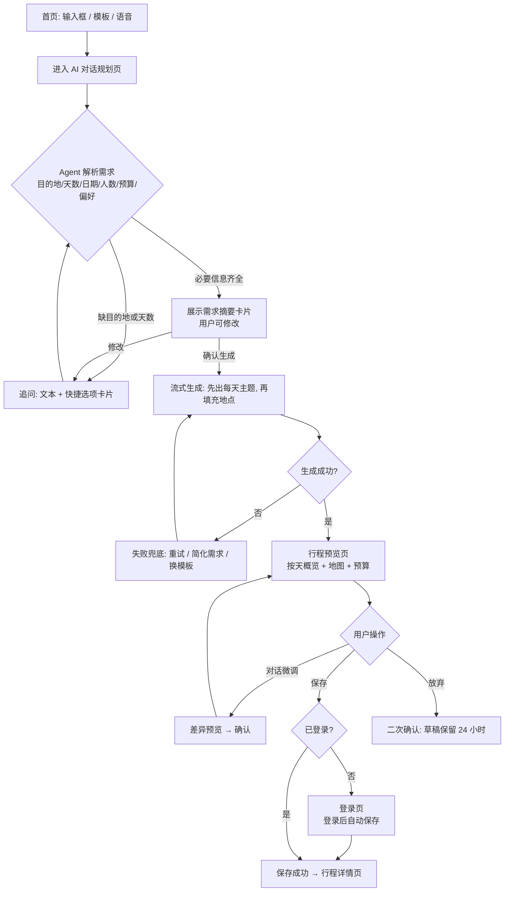
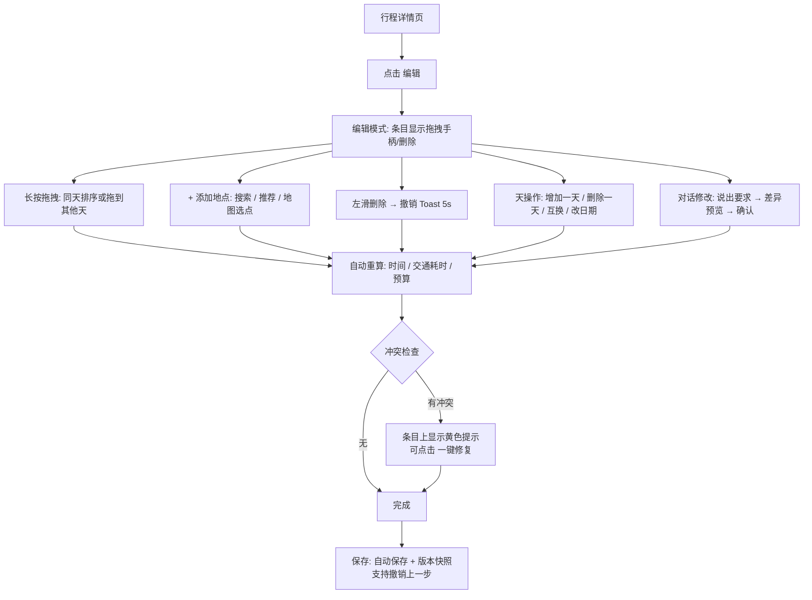
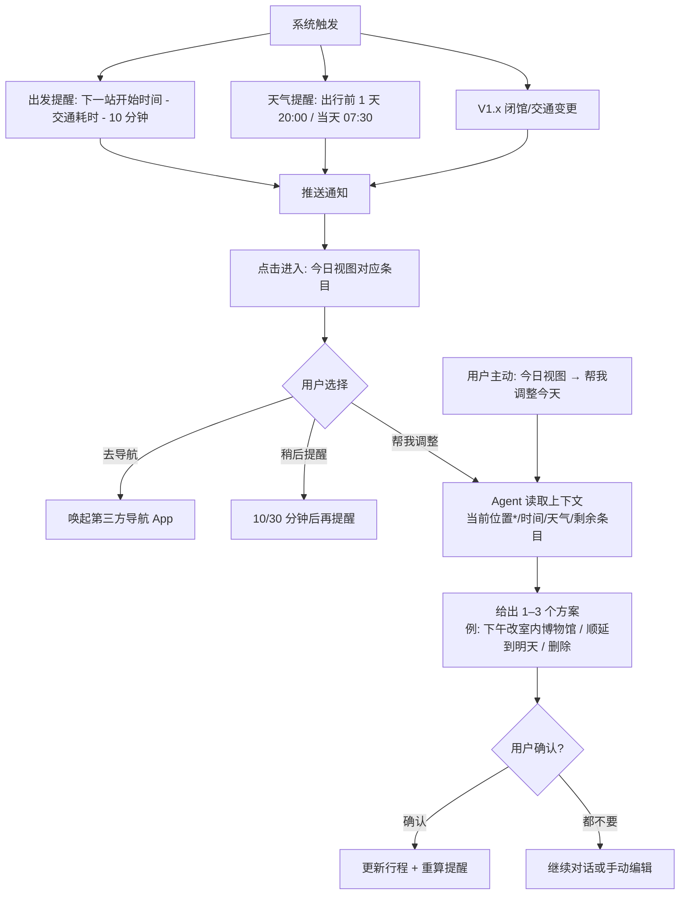

# 去哪玩：旅行规划 Agent 产品需求文档 PRD

> 本文中标注「【假设】」的内容为信息不足时的默认假设，需在第 10 章逐项确认后再定稿。

---

## 1. 文档信息与产品概述

### 1.1 文档信息

| 项目 | 内容 |
|---|---|
| 文档名称 | 旅行规划 Agent PRD |
| 版本 | v0.1 |
| 日期 | 2026-10-19 |
| 状态 | 初稿待确认 |
| 负责人 | jinxu liu |
| 读者 | UI 设计、研发、测试 |
| 产品名 | 「去哪玩」（用户已确认，2026-10-19） |
| 视觉方向 | 黑白灰为主，配色约 6:3:1（用户已确认，2026-10-19）；点缀色蓝色（#2563EB，用户已确认）；原青绿主题色已废弃 |
| 设计方式 | HTML 代码高保真原型（移动端 390×844 视口），源码与自动截图放 `docs/travel-planner/design/`；Pencil 试做与 Figma v0.1 仅作历史参考（用户已确认，2026-10-19） |

### 1.2 一句话定位

**一个用一句话就能生成、在手机上随手改、出门时会主动提醒的 AI 旅行规划助手。**

### 1.3 要解决的问题

| # | 用户痛点 | 现状 | 本产品的解法 |
|---|---|---|---|
| 1 | 做攻略耗时 | 在小红书、点评、地图等多个 App 之间来回切换，整理一份 3 天行程常需 3–6 小时 | 一句话需求 → Agent 追问关键信息 → 1 分钟内生成按天行程 |
| 2 | 行程不合理 | 景点顺序绕路、开放时间冲突、一天塞太满 | 结合 POI 营业时间、点间距离/耗时自动排序，并做冲突检查 |
| 3 | 改行程麻烦 | 文档/截图形式的攻略难以修改 | 拖拽调整顺序、换日，也可以用对话改（"第二天轻松点"） |
| 4 | 行中信息分散 | 天气、出发时间、闭馆要自己查 | 行中主动提醒，并一键给出调整方案 |
| 5 | 预算心里没数 | 花费靠拍脑袋 | 生成行程时一并估算分项预算 |

### 1.4 产品目标

| 阶段 | 目标 |
|---|---|
| MVP（1 个迭代周期，约 6–8 周【假设】） | 跑通「一句话生成 → 编辑 → 保存 → 行中查看/提醒」闭环，验证生成质量和留存 |
| V1.x | 补充协作、记账、更多实时提醒，提高行中使用频次 |
| 远期 | 视验证结果决定是否接入预订与变现 |

### 1.5 成功指标（建议值，均为【假设】，需结合基线数据校准）

| 指标 | 定义 | MVP 目标建议值 |
|---|---|---|
| 生成成功率 | 发起规划后成功产出完整行程的比例 | ≥ 90% |
| 行程保存率 | 生成结果被保存的比例 | ≥ 50% |
| 首次生成耗时 | 从确认需求到行程完整展示（P90） | ≤ 30 秒；首屏流式内容 ≤ 3 秒 |
| 编辑采纳度 | 已保存行程中，被用户修改且保留的条目占比 | 仅观察，不设目标（用来判断生成质量） |
| 行程满意度 | 生成结果页"有用/没用"中"有用"的比例 | ≥ 70% |
| 行中打开率 | 出行期间至少打开 1 次 App 的行程占比 | ≥ 40% |
| 次周留存 | 新用户 D7 留存 | ≥ 20% |
| 提醒点击率 | 推送提醒的点击率 | ≥ 15% |

---

## 2. 目标用户与场景

### 2.1 用户画像

| 画像 | 基本信息 | 出行特征 | 核心诉求 | 典型一句话需求 |
|---|---|---|---|---|
| A. 周末打工人「小林」 | 27 岁，一线城市白领 | 周末/小长假，2–3 天短途，自由行 | 省时间，不想做攻略，别太累 | "下周末从上海去杭州两天，不想太赶" |
| B. 亲子家庭「王姐」 | 36 岁，带 6 岁孩子 + 老人 | 寒暑假，4–6 天，自驾或高铁 | 节奏慢、有午休、孩子能玩、餐厅友好 | "暑假带娃和爸妈去西安 5 天，自驾" |
| C. 学生/穷游党「阿杰」 | 21 岁，大学生 | 节假日，3–7 天，结伴出行 | 预算紧，路线高效，多人一起商量 | "国庆和室友 3 人去成都 4 天，人均 2000" |
| D. 出境自由行「Lisa」【假设，MVP 次要】 | 30 岁，有出境经验 | 年假 5–10 天，日韩/东南亚 | 交通衔接、语言、开放时间、离线可用 | "明年 3 月东京大阪 7 天，想看樱花" |

> 【假设】MVP 主攻画像 A、B、C（国内游）；画像 D 用于验证需求，不做专门适配。见 Q1。

### 2.2 典型使用场景

| 阶段 | 场景 | 触发 | 用户行为 | 产品响应 |
|---|---|---|---|---|
| 行前 | 灵感 → 行程 | 决定出行或仅有模糊想法 | 输入一句话或选模板 | Agent 追问 2–4 个关键问题，生成按天行程和预算 |
| 行前 | 细化调整 | 对生成结果部分不满意 | 拖拽、增删景点、换日，或者对话修改 | 实时重算路线耗时和预算，提示冲突 |
| 行前 | 分享确认 | 需要同行人意见 | 生成只读分享链接/长图 | 同行人免登录查看 |
| 行中 | 当天导航 | 出门前或在途中 | 打开"今天"视图 | 显示下一站、出发时间、路线，一键跳转导航 App |
| 行中 | 临时调整 | 下雨、累了、景点闭馆、排队太长 | 收到提醒或主动说"下午换个室内的" | Agent 给出 1–3 个替换方案，用户确认后更新 |
| 行后 | 回顾【V1.x】 | 行程结束 | 查看足迹和实际花费 | 生成回顾卡片，可分享或复用为模板 |

---

## 3. 核心功能

### 3.1 功能范围总表

| 模块 | 功能 | 用户价值 | 简要描述 | 版本 | 优先级 |
|---|---|---|---|---|---|
| AI 规划 | 对话式生成行程 | 一句话出行程，省掉攻略时间 | 自然语言输入 → 结构化抽取（目的地、日期、人数、预算、偏好）→ 生成按天行程，流式展示 | MVP | P0 |
| AI 规划 | 追问澄清 | 避免生成不贴合的结果 | 缺目的地/天数时必须追问；偏好/预算缺失时给快捷选项，也可以跳过 | MVP | P0 |
| AI 规划 | 对话式修改 | 不用手动编辑也能改 | 在行程上下文中说"第二天轻松点""换掉某景点"，以差异预览的形式返回，用户确认后生效 | MVP | P1 |
| AI 规划 | 灵感模板 | 降低首次输入门槛 | 首页展示热门目的地/主题模板（周末、亲子、美食） | MVP | P1 |
| 行程编辑 | 拖拽排序/跨天移动 | 快速调整顺序 | 时间轴内长按拖拽，可拖到其他天；自动重算时间 | MVP | P0 |
| 行程编辑 | 增删地点 | 加上自己想去的地方 | 搜索 POI 添加、左滑删除、从推荐中添加 | MVP | P0 |
| 行程编辑 | 增删/调换日期 | 行程天数变了也能改 | 增加/删除一天，两天整体互换，修改出发日期 | MVP | P0 |
| 行程编辑 | 冲突检查 | 避免白跑 | 检查营业时间冲突、单日过满（时长阈值）、跨城距离不合理，以黄色提示 | MVP | P1 |
| 行程编辑 | 备注/自定义条目 | 记录个人信息 | 给条目加备注，添加自定义事项（如"取票"） | MVP | P1 |
| 地图与路线 | 行程地图视图 | 直观看到动线 | 按天展示点位和连线，切换天，点位与列表联动 | MVP | P0 |
| 地图与路线 | 点间交通估算 | 知道路上要多久 | 相邻点之间显示推荐方式（步行/公交/驾车/打车）及耗时 | MVP | P0 |
| 地图与路线 | 跳转第三方导航 | 用熟悉的导航 App 出行 | 一键唤起高德/百度/Apple 地图【假设】 | MVP | P0 |
| 地图与路线 | 路线自动优化 | 少走回头路 | 按距离为单日点位重新排序（用户确认后应用） | V1.x | P1 |
| 推荐 | 景点推荐 | 找到值得去的地方 | 基于目的地和偏好推荐，附简介、建议游玩时长、开放时间 | MVP | P0 |
| 推荐 | 餐饮推荐 | 解决"附近吃什么" | 按行程位置和用餐时段推荐附近餐厅 | MVP | P1 |
| 推荐 | 酒店推荐 | 住在方便的位置 | 推荐住宿区域和若干酒店参考（仅展示，不预订） | MVP | P1 |
| 推荐 | 城际交通建议 | 知道怎么到达 | 文字建议（高铁/飞机/自驾及大致耗时、费用），不查实时余票 | MVP | P2 |
| 推荐 | 实时价格/余票 | 决策更准 | 接入 OTA/12306 数据源 | 暂不做 | — |
| 预算 | 预算估算 | 提前知道花多少 | 按交通/住宿/餐饮/门票/其他分项粗估，显示区间和人均 | MVP | P0 |
| 预算 | 预算上限对比 | 控制花费 | 设置预算上限，超出时提示并可让 Agent 压缩 | MVP | P2 |
| 预算 | 行中记账 | 记录实际花费 | 手动记一笔，分类、AA 分摊、实际与预估对比 | V1.x | P1 |
| 行中提醒 | 出发提醒 | 不错过时间 | 根据下一站开始时间和交通耗时，本地推送"该出发了" | MVP | P0 |
| 行中提醒 | 天气提醒 | 提前应对恶劣天气 | 出行前 1 天和当天早上推送天气；有雨时附带室内替代建议 | MVP | P1 |
| 行中提醒 | 闭馆/营业变更提醒 | 避免白跑 | 检测 POI 临时闭馆、节假日调整 | V1.x | P1 |
| 行中提醒 | 交通变更提醒 | 航班/列车变动及时知道 | 需要导入票务信息并接入动态数据 | V1.x | P2 |
| 行中 | 今日视图 | 行中一屏看清 | 首页在出行期间切换为"今天"卡片：下一站、倒计时、天气 | MVP | P0 |
| 行中 | 临时调整 | 计划被打乱时快速重排 | 一键"帮我调整今天"，Agent 给替换方案 | MVP | P1 |
| 协作分享 | 只读分享 | 同行人能看到行程 | 生成分享链接（H5 免登录查看）/长图 | MVP | P1 |
| 协作分享 | 多人协同编辑 | 一起商量行程 | 邀请成员编辑、评论、投票 | V1.x | P1 |
| 离线 | 离线查看 | 没信号时也能看 | 已保存行程的文本和地点信息本地缓存；地图瓦片不缓存 | MVP | P1 |
| 离线 | 离线地图 | 境外/山区可用 | 下载离线地图包 | 暂不做 | — |
| 账号 | 登录与云同步 | 换机不丢数据 | 手机号验证码 + 微信/Apple 登录【假设】；未登录可以体验生成，保存时要求登录 | MVP | P0 |
| 个人 | 偏好设置 | 生成更贴合 | 出行节奏、兴趣标签、饮食禁忌、默认预算档位 | MVP | P1 |
| 行后 | 行程回顾 | 留存与分享 | 足迹地图、花费总结、回顾卡片 | V1.x | P2 |
| 行后 | 复制为模板 | 复用 | 复制他人分享的行程到自己的账号 | V1.x | P2 |
| 交易 | 预订下单/支付 | 一站式完成 | 酒店/门票/交通下单 | 暂不做 | — |
| 社区 | UGC 攻略社区 | 内容生态 | 发布、浏览攻略 | 暂不做 | — |
| 其他 | 签证/保险/法律咨询 | — | 涉及合规风险 | 暂不做 | — |

### 3.2 MVP 范围说明（克制原则）

- **必须闭环**：生成 → 预览 → 保存 → 编辑 → 地图 → 行中今日视图/出发提醒。
- **P0 共 13 项**，P1 视排期取舍；排期紧时 P1 的砍除顺序为：酒店推荐 → 对话式修改 → 冲突检查 → 天气提醒。
- **不接入任何交易**；价格均为估算并明示。
- **单人使用**：协作只做只读分享。
- 【假设】MVP 只支持**国内单目的地或同省/邻近 2 城**，不支持复杂多国联程。

---

## 4. 关键用户流程

### 4.1 流程一：从一句话需求到生成并保存行程



**规则**
- 必填槽位：目的地、天数（或起止日期）。其余槽位缺失时使用默认值：2 人、舒适档预算、中等节奏，并在需求摘要卡片中标明为默认值。
- 追问最多 3 轮，超出后按默认值生成，并提示"可随时修改"。
- 未登录用户生成的草稿保存在本地；登录后同步上云。

### 4.2 流程二：编辑行程



**规则**
- 编辑实时自动保存（防抖 1 秒）；每次进入编辑模式前生成一个快照，可"恢复到编辑前"。
- 删除一天时，若该天有条目，需二次确认，条目可选择移入"待安排"池。
- "待安排"池：未分配到具体日期的地点，在编辑模式顶部可折叠展示。

### 4.3 流程三：行中提醒与临时调整



> *当前位置仅在用户授予定位权限后使用；未授权时以"下一站/上一站"作为位置基准。

---

## 5. 移动端信息架构

### 5.1 底部 Tab（5 个，中间为 AI）

| 位置 | 名称 | 作用 |
|---|---|---|
| 1 | 首页 | 规划入口、灵感模板、出行中显示今日视图 |
| 2 | 行程 | 我的行程列表（即将出发/草稿/已完成） |
| 3（中间） | AI | 直接进入 AI 对话规划页；普通 Tab 样式，不做悬浮＋按钮 |
| 4 | 消息 | 提醒与通知，有未读时显示角标 |
| 5 | 我的 | 个人中心、偏好、设置 |

【决定 2026-10-19】中间悬浮＋按钮取消，改为普通「AI」Tab；保留「消息」Tab，因为出行中的天气、闭馆、交通提醒（P11）需要固定入口。

### 5.2 页面层级

```text
启动页 / 引导页（首次）→ 偏好快速设置（可跳过）→ 登录（可延后）
│
├─ Tab1 首页
│   ├─ AI 对话规划页
│   │   └─ 行程生成结果/预览页
│   │       ├─ 地图视图
│   │       ├─ 预算页
│   │       └─ 地点详情页
│   ├─ 模板详情 → AI 对话规划页（预填）
│   └─ 今日视图卡片（出行中）→ 行程详情（定位到今天）
│
├─ Tab3 AI → AI 对话规划页
│
├─ Tab2 行程
│   └─ 我的行程列表
│       └─ 行程详情页（按天时间轴）
│           ├─ 行程编辑页
│           │   ├─ 添加地点（搜索 / 推荐 / 地图选点）
│           │   └─ 对话修改面板（底部抽屉）
│           ├─ 地图视图
│           │   └─ 地点详情页（景点 / 餐厅 / 酒店）
│           ├─ 预算页
│           ├─ 行程设置（名称、日期、人数、删除）
│           └─ 分享面板（链接 / 长图）
│
├─ Tab4 消息
│   └─ 提醒/通知列表 → 对应行程条目 / 调整方案
│
└─ Tab5 我的
    ├─ 账号信息 / 登录
    ├─ 旅行偏好设置
    ├─ 通知设置
    ├─ 权限与隐私（定位、通知、数据导出/注销）
    ├─ 离线数据管理
    └─ 关于 / 反馈 / 用户协议
```

---

## 6. 主要页面清单（UI 设计重点）

> 通用约定：
> - 加载：列表/卡片使用骨架屏；AI 生成使用流式渲染 + 进度文案。
> - 异常：网络异常统一使用顶部横幅"网络不可用，正在显示离线内容"；接口失败使用页面级空态 + 重试按钮。
> - 所有 AI 生成内容旁显示小标识「AI 生成·仅供参考」。
> - 适配：iOS/Android 主流尺寸，支持深色模式【假设，MVP 可选】、系统字号放大。

### 6.1 P01 启动页 / 引导页

| 项 | 内容 |
|---|---|
| 页面目的 | 品牌露出；首次用户 3 屏以内理解价值，并完成最少的偏好设置 |
| 模块（上→下） | ①启动页：Logo + Slogan（≤ 1.5 秒）②引导轮播 3 屏：一句话生成 / 随手编辑 / 行中提醒（每屏插画 + 标题 + 一句说明）③偏好快速设置（可跳过）：出行节奏（悠闲/适中/紧凑）、兴趣标签多选（自然、人文、美食、购物、亲子、夜生活…）④按钮：「开始规划」「跳过」 |
| 关键交互 | 左右滑动切换；最后一屏进入偏好设置；完成后直接进入首页，不强制登录；通知权限在首次保存行程后再申请（不在引导页申请） |
| 空状态 | 无 |
| 加载 | 启动时预取配置，超过 3 秒直接进入首页并使用默认配置 |
| 异常 | 无网络：仍可进入首页，顶部显示离线横幅；版本过低：强制/建议更新弹窗 |

### 6.2 P02 首页

| 项 | 内容 |
|---|---|
| 页面目的 | 最快进入规划；出行中变成"今日"驾驶舱 |
| 模块（上→下） | ①顶部：问候语 + 当前城市（定位授权后）②**今日视图卡片**（仅出行中显示，置顶）：行程名、第 N 天、天气、下一站名称 + 计划时间 + 出发倒计时、按钮「导航」「帮我调整今天」③**主输入框**：占位文案"想去哪儿？比如：下周末上海去杭州玩两天"，带语音按钮④快捷标签：周末短途 / 亲子 / 美食 / 预算友好⑤即将出发的行程（最多 2 张卡片，含倒计时）⑥灵感模板：横滑卡片（目的地图 + 天数 + 主题）⑦最近草稿（如有） |
| 关键交互 | 点击输入框 → 进入对话页并弹起键盘；点击快捷标签 → 预填文本进入对话页；点击模板 → 模板详情或直接预填；下拉刷新 |
| 空状态 | 新用户：没有"即将出发"模块，模板区放大展示，并加一行引导文案"试试说一句话" |
| 加载 | 模板区骨架屏；今日卡片的天气单独加载，失败时显示"--" |
| 异常 | 模板加载失败时隐藏该区，不影响输入框；定位失败时不显示城市 |

### 6.3 P03 AI 对话规划页

| 项 | 内容 |
|---|---|
| 页面目的 | 通过对话收集需求并触发生成；也是"对话修改"的承载页 |
| 模块（上→下） | ①导航栏：返回、标题"规划新行程"、右侧「新对话」②消息流：用户气泡 / Agent 气泡；Agent 可以发**结构化卡片**：快捷选项卡（日期选择、人数步进、预算档位、节奏）、**需求摘要卡**（目的地、日期、天数、人数、预算、偏好，每项可点击修改；默认值标"默认"）、生成进度卡（"正在规划第 2 天…"）、行程摘要卡（点击进入预览）③底部输入区：文本框 + 语音 + 发送；输入框上方有推荐回复胶囊（如"不限预算""带老人"） |
| 关键交互 | 流式逐字输出；生成过程中可点「停止」；需求摘要卡点击「开始生成」；长按消息可复制；生成完成后自动跳转预览页（可设置为停留）；返回时如有未完成对话，保留为草稿 |
| 空状态 | 首次进入：Agent 欢迎语 + 3 个示例问法（可点击） |
| 加载 | Agent 回复前显示"正在思考"三点动画；生成阶段显示分步进度（理解需求 → 挑选地点 → 规划路线 → 估算预算） |
| 异常 | 超时/失败：Agent 气泡给出"生成没有完成"+「重试」「简化需求重试」；不支持的需求（如多国联程、签证办理）：明确说明边界并给替代建议；敏感/违规内容：礼貌拒绝；网络断开：输入区置灰 + 横幅 |

### 6.4 P04 行程生成结果 / 预览页

| 项 | 内容 |
|---|---|
| 页面目的 | 让用户快速判断"行不行"，然后保存或微调 |
| 模块（上→下） | ①头图区：目的地图片 + 行程名（AI 生成，可改）+ 日期·天数·人数②概要条：总预算区间 / 人均、景点数、每日节奏标签③**按天概览卡**（可折叠，第 1 天默认展开，其余收起）：第 N 天主题（如"西湖慢游"）+ 当天总时长 + 地点列表（每条：时段、名称、类型图标、建议停留时长；相邻地点之间一行交通方式与耗时）；收起时只显示主题 + 地点名串④迷你地图（点击进入地图视图）⑤预算分项条形图（点击进入预算页）⑥AI 说明："为什么这样安排"（2–3 条要点）+ 数据来源与免责提示⑦反馈：有用 / 没用（没用时可选原因）⑧底部固定操作栏：「对话微调」「保存行程」（主按钮） |
| 关键交互 | 点击地点进入地点详情；「对话微调」从底部弹出对话抽屉，修改结果以**差异预览**展示（新增标绿、删除标红加删除线、调整用灰底，均带文字标签；蓝色不用于差异），按钮「应用」「撤销」；保存时未登录则弹出登录；保存后进入行程详情 |
| 空状态 | 无（必有内容） |
| 加载 | 流式填充：先出每天主题骨架，再逐项填充地点；图片懒加载 |
| 异常 | 部分 POI 信息缺失：该条目显示"信息待补充"，不阻塞保存；地图加载失败：显示列表；预算估算失败：显示"暂无法估算"+ 重试 |

### 6.5 P05 行程详情页（按天时间轴）

| 项 | 内容 |
|---|---|
| 页面目的 | 已保存行程的主视图，行前查看、行中执行都在这里 |
| 模块（上→下） | ①导航栏：返回、行程名、右侧「分享」「更多」（设置/复制/删除）②头部信息：日期、人数、预算概要、天气概览（出行前 7 天内显示）③**日期切换条**：横滑 Day1/Day2…（显示日期与星期，出行中"今天"高亮）④视图切换：列表 / 地图⑤**时间轴**：每个条目包含时间段、类型图标（景/餐/住/行/自定义）、名称、建议时长、评分/价格档、备注；相邻条目之间是**交通段**（方式图标 + 耗时 + 距离，点击切换方式）；冲突提示（黄色）⑥当天小结：总步行距离、当天花费估算⑦底部浮动：「编辑」「问 AI」 |
| 关键交互 | 左右滑动时间轴切换天；点击条目进入地点详情；点击交通段 → 唤起导航；出行中自动定位到"今天"和下一个条目，已完成条目置灰并打勾（按时间自动判断，也可手动打勾）；「问 AI」打开对话抽屉 |
| 空状态 | 某天无条目："这一天还没有安排" +「添加地点」「让 AI 安排这一天」 |
| 加载 | 首次进入使用骨架屏；有本地缓存时先显示缓存再静默刷新 |
| 异常 | 离线：显示缓存 + 顶部横幅；MVP 离线只读，「编辑」「问 AI」置灰并提示"联网后可编辑"【假设，见 Q13】；行程已被删除（多端）：提示并返回列表 |

### 6.6 P06 行程编辑页

| 项 | 内容 |
|---|---|
| 页面目的 | 手动精细调整行程 |
| 模块（上→下） | ①导航栏：「取消」、标题"编辑行程"、「完成」②日期条（编辑态）：每天右上角有"···"（删除这天/与某天互换/修改日期）；末尾是「+ 加一天」③**待安排池**（可折叠，显示数量角标）④时间轴（编辑态）：条目左侧拖拽手柄、右侧删除；条目可点击修改时间/时长/备注⑤每天末尾「+ 添加地点」⑥底部：「撤销」「重做」+ 对话修改入口 |
| 关键交互 | 长按拖拽：在同一天内排序，拖到顶部日期条上可移到其他天（日期标签高亮吸附）；拖动时显示占位线并轻微震动；放下后重算时间，交通段显示 loading；删除后显示 Toast「已删除 · 撤销」（5 秒）；添加地点：搜索页（搜索框 + 附近推荐 + 收藏）、地图选点；「完成」保存并退出，「取消」时如有改动需二次确认（实际已自动保存，取消 = 恢复到编辑前快照） |
| 空状态 | 待安排池为空时隐藏；某天为空时显示虚线占位"把地点拖到这里" |
| 加载 | 重算交通/预算时局部 loading，不阻塞继续编辑 |
| 异常 | 重算失败：交通段显示"耗时未知"；冲突：黄色提示 +「一键修复」（Agent 给方案）；保存失败：本地保留，并提示"稍后自动重试" |

### 6.7 P07 地图视图

| 项 | 内容 |
|---|---|
| 页面目的 | 空间维度查看动线，辅助判断路线是否合理 |
| 模块（上→下） | ①顶部：返回 + 日期切换胶囊（全部/Day1/Day2…，每天一个颜色）②全屏地图：编号点位（按顺序）+ 连线；酒店使用特殊图标；"我的位置"（授权后）③右侧悬浮：定位、图层（显示附近餐饮）④底部卡片横滑列表：与点位一一对应（名称、时段、到下一站耗时）⑤卡片上「导航」按钮 |
| 关键交互 | 点击点位 ↔ 卡片联动居中；横滑卡片时地图跟随；点击卡片进入地点详情；「导航」唤起第三方 App 选择面板（底部动作面板：高德地图 / 百度地图 / Apple 地图 + 取消；原型里不真跳转，但要能看到这个面板，作为 P07 的一个补充状态）。首页今日卡片、预览页、详情页、消息通知、地点详情等所有「导航」入口都在原地直接弹这个面板，不先跳到地图页；双指缩放；切换天时自动缩放到全部点位 |
| 空状态 | 当天无地点：地图显示目的地城市中心 + 提示"这一天还没有地点" |
| 加载 | 地图瓦片加载中显示浅灰网格；点位先出，连线后出 |
| 异常 | 地图 SDK 加载失败或离线：降级为"列表 + 静态说明"，并提示"地图需要联网"；POI 缺坐标：卡片标"位置未知"，不在地图上显示 |

### 6.8 P08 地点详情页（景点 / 餐厅 / 酒店）

| 项 | 内容 |
|---|---|
| 页面目的 | 帮用户判断要不要去，以及什么时候去 |
| 模块（上→下） | **通用**：①图片轮播（来源标注）②名称 + 类型标签 + 评分 + 价格档③核心信息：地址（可复制）、营业时间（今日状态"营业中/已闭馆"）、电话④AI 一句话推荐理由 + 建议游玩时长 + 推荐时段⑤小地图 + 「导航」⑥数据来源与更新时间⑦底部操作栏：「加入行程」/「已在第 N 天」、「替换为…」、收藏（收藏只放一处，不与导航栏重复）。未在行程时「加入行程」是蓝色主按钮；已在行程时同一位置显示「已在第 N 天」（次级样式），不另做页面，两种状态都要有。**景点特有**：门票参考价、是否需预约（提示"以官方为准"）。**餐厅特有**：人均、推荐菜（如有）、是否需排队提示。**酒店特有**：参考价区间、所在区域优缺点、距行程点的平均距离；「去预订」MVP 不提供（见 Q3） |
| 关键交互 | 「加入行程」→ 弹出选择天和位置（默认按距离推荐插入位置），确认后按钮变为「已在第 N 天」；「导航」与 P07 相同，弹出第三方地图选择面板；「替换为…」→ Agent 推荐同类附近的 3 个替代；电话点击拨打；地址长按复制 |
| 空状态 | 无图片：类型占位插画；无营业时间："营业时间未知，建议出发前确认" |
| 加载 | 骨架屏；图片渐进加载 |
| 异常 | POI 已关闭/查不到：顶部红色横幅"该地点可能已停业"+「替换」；加载失败：重试 |

### 6.9 P09 预算页

| 项 | 内容 |
|---|---|
| 页面目的 | 了解总花费构成，并能调整预算 |
| 模块（上→下） | ①总额卡：预估总额区间 + 人均 + 预算档位（经济/舒适/品质）；若设置了上限，显示进度条②分项环形图/条形图：交通（城际 + 市内）、住宿、餐饮、门票、其他③分项明细列表：可展开到每天、每个条目④估算说明：口径（按 N 人、N 晚，币种 CNY）、数据来源、"仅供参考"⑤操作：「设置预算上限」「让 AI 帮我省钱」⑥【V1.x】记账入口：「记一笔」、实际 vs 预估 |
| 关键交互 | 切换人均/总价；点击分项展开明细；修改单项估算（手动覆盖，标"已手动修改"）；超出上限时显示红色提示和「压缩方案」 |
| 空状态 | 行程无条目："添加地点后自动估算" |
| 加载 | 数字区块骨架屏 |
| 异常 | 部分条目无价格：计入"未知项 N 个"，总额显示为"≥ X" |

### 6.10 P10 我的行程列表

| 项 | 内容 |
|---|---|
| 页面目的 | 管理所有行程 |
| 模块（上→下） | ①标题 + 搜索图标②分段：出行中 / 即将出发 / 草稿 / 已完成（出行中单独一组，用户已确认原型做法）③行程卡片：封面图、行程名、目的地、日期、天数、状态标签（出行中/X 天后出发/草稿）、离线可用标识④右下「＋ 新建」 |
| 关键交互 | 点击进入详情（草稿则进入预览/对话页；出行中的行程进入行程详情的出行中视图，卡片必须可点）；左滑：删除（二次确认）/复制；长按：重命名/置顶；下拉刷新 |
| 空状态 | 插画 + "还没有行程，说一句话就能开始" +「开始规划」 |
| 加载 | 卡片骨架屏 ×3 |
| 异常 | 未登录：显示本地草稿 + 顶部提示"登录后同步行程"；同步失败：卡片标"未同步"图标 |

### 6.11 P11 提醒 / 通知页

| 项 | 内容 |
|---|---|
| 页面目的 | 集中查看行中提醒和系统消息 |
| 模块（上→下） | ①标题 + 「全部已读」+ 设置入口②筛选：全部 / 行程提醒 / 系统③通知列表（按时间分组：今天/更早）：类型图标（出发/天气/闭馆/系统）、标题、摘要、时间、关联行程；未读圆点④有动作的通知内嵌按钮：「导航」「查看调整方案」「稍后提醒」 |
| 关键交互 | 点击跳转关联行程的对应条目；「查看调整方案」打开 Agent 方案抽屉（1–3 个方案卡 + 确认）；左滑删除 |
| 空状态 | "暂无提醒，出行时我们会在关键时刻提醒你" |
| 加载 | 列表骨架屏 |
| 异常 | 系统通知权限未开：顶部横幅"开启通知，不错过出发时间" +「去开启」；加载失败：重试 |

### 6.12 P12 个人中心 / 偏好设置

| 项 | 内容 |
|---|---|
| 页面目的 | 账号管理；设置个性化偏好以提升生成质量；隐私管理 |
| 模块（上→下） | ①头部：头像、昵称、登录状态（未登录显示「登录/注册」）②数据卡：已规划行程数、去过的城市数③**旅行偏好**：出行节奏、兴趣标签、饮食禁忌/偏好、默认预算档位、常用出发城市、同行人类型（独自/情侣/亲子/长辈/朋友）④通知设置：出发提醒提前量（10/20/30 分钟）、天气提醒开关、免打扰时段⑤权限与隐私：定位权限状态、通知权限状态、个性化推荐开关、导出我的数据、注销账号⑥离线数据：已缓存行程、占用空间、清除⑦其他：语言（MVP 仅简体中文）、关于、意见反馈、用户协议/隐私政策、退出登录 |
| 关键交互 | 偏好修改即时保存，并提示"将用于下次规划"；权限项点击跳转系统设置；注销需二次验证（短信验证码或登录密码）+ 冷静期说明：提交后 15 天内重新登录可撤销，逾期删除云端行程与偏好且无法找回；「确认注销」可用红色（不可恢复操作）；「导出我的数据」「注销账号」属合规必需，不能删，可放二级页「账号与安全」；「清除缓存」可恢复，用灰色次级按钮 + 二次确认，不用红色（红色只用于不可恢复的删除、超预算、已停业等风险提示） |
| 空状态 | 未登录：偏好可本地设置，提示"登录后同步" |
| 加载 | 头部数据骨架屏 |
| 异常 | 保存失败 Toast + 自动重试 |

### 6.13 附：登录页 / 分享面板（辅助页面）

| 页面 | 要点 |
|---|---|
| 登录页 | 底部弹出半屏；手机号一键登录 / 验证码、微信、Apple（iOS）【假设】；勾选协议；"登录后将保存当前行程"文案 |
| 分享面板 | 底部抽屉：复制链接、微信好友、生成长图（含二维码）；链接默认只读、可随时关闭；H5 查看页（不在本 App 范围，需单独设计简版） |

---

## 7. Agent 能力边界

### 7.1 能做什么

| 能力 | 说明 | 依赖 |
|---|---|---|
| 理解需求 | 从自然语言中抽取目的地、日期/天数、人数及构成、预算、节奏、兴趣、禁忌、交通方式 | 大模型 |
| 追问澄清 | 必填槽位缺失时追问；最多 3 轮；优先用选项卡片降低输入成本 | 大模型 + 槽位规则 |
| 生成行程 | 按天分配地点，考虑营业时间、游玩时长、点间耗时、用餐时段、住宿位置 | 大模型 + POI + 路线 API |
| 调整行程 | 理解"轻松点""换室内""删掉 X""加一个夜市"等指令，以差异的形式返回 | 大模型 |
| 调用数据工具 | 地图/POI 搜索、路线耗时、天气预报、营业时间 | 第三方 API（见 Q4） |
| 估算预算 | 基于 POI 价格档、门票参考价、住宿区间、交通里程估算分项区间 | 规则 + 数据 |
| 行中调整建议 | 根据时间、天气、剩余条目、位置（授权时）给 1–3 个方案 | 同上 |

### 7.2 不做什么（MVP）

| 不做 | 说明 / 对用户的话术 |
|---|---|
| 直接下单、支付、预订 | "我可以帮你规划，但暂不支持预订，可以前往官方或常用平台预订" |
| 保证价格、余票、营业时间实时准确 | 所有价格标"参考"，营业时间标来源和更新时间 |
| 签证、出入境、法律、医疗、保险意见 | 拒答 + 建议查询官方渠道 |
| 替用户做安全判断（如野外徒步、极端天气出行） | 只给风险提示，不做"安全"保证 |
| 生成不存在的地点 | 所有地点必须能匹配到 POI 库；匹配失败的地点不进入行程（或标"未验证"，见 7.4） |
| 复杂多国/多城联程、跟团游比价 | 提示暂不支持，建议拆分规划 |

### 7.3 数据来源与可信度提示

| 数据 | 来源【假设】 | 展示方式 |
|---|---|---|
| POI 基础信息、坐标、营业时间 | 地图服务商 POI（高德/腾讯等，见 Q4） | 详情页底部显示"数据来源：XX · 更新于 YYYY-MM-DD" |
| 评分、人均 | POI 服务商或合作内容源 | 标"参考" |
| 门票/酒店价格 | 公开参考价 / 模型估算 | 一律以区间展示 +「仅供参考」 |
| 路线耗时 | 路线规划 API | 标"预计"；API 失败时用直线距离粗估，并标"粗估" |
| 天气 | 天气服务商 | 显示来源 |
| 推荐理由、行程编排 | 大模型生成 | 「AI 生成·仅供参考」标识 |

### 7.4 失败兜底

| 失败场景 | 兜底策略 |
|---|---|
| 大模型超时/报错 | 自动重试 1 次 → 提示「重试」「简化需求」；保留已收集的槽位 |
| 生成结果不完整（某天为空） | 补齐该天；仍失败时该天显示「让 AI 再试一次」 |
| 地点匹配不到 POI | 丢弃并用同类地点替换；替换不了时标"未验证地点"，不计入路线 |
| 路线 API 失败 | 直线距离 × 系数粗估，标"粗估" |
| 天气 API 失败 | 不显示天气，不阻塞其他功能 |
| 需求超出能力 | 明确说明边界 + 给出能做的替代方案 |
| 内容安全拦截 | 通用礼貌拒答 |

### 7.5 人工确认点（Agent 不得自动执行）

1. 生成前：需求摘要卡由用户确认（可一键跳过，直接按默认值生成）。
2. 对话修改已保存的行程：先展示差异预览，用户点「应用」后才生效。
3. 行中调整方案：用户选择方案后才更新行程和提醒。
4. 删除一天/删除行程：二次确认。
5. 任何对外操作（分享链接生成、未来接入的预订）：用户主动触发。

### 7.6 隐私与位置权限

| 项 | 策略 |
|---|---|
| 定位权限 | 仅申请"使用期间"；在首次使用今日视图或"附近"功能时申请，申请前先弹出说明；拒绝后功能降级，不反复弹窗 |
| 后台定位 | MVP 不申请 |
| 通知权限 | 首次保存行程后申请，前置说明"用于出发和天气提醒" |
| 对话数据 | 用于生成和改进服务，需在隐私政策中说明；提供"不用于模型改进"开关【假设】 |
| 敏感信息 | 不主动收集身份证/护照号；用户输入时提示不要提供 |
| 数据删除 | 支持删除单条行程、清空对话、注销账号（同时删除数据） |

---

## 8. 非功能需求

| 类别 | 要求（建议值均为【假设】） |
|---|---|
| 性能 | 冷启动 ≤ 2 秒（中端机）；页面切换 ≤ 300 毫秒；AI 首个 token ≤ 3 秒；完整 3 天行程生成 P90 ≤ 30 秒；编辑重算局部 ≤ 1 秒；列表滚动 ≥ 55 fps |
| 可用性 | 服务可用性 ≥ 99.5%；AI 服务降级时至少可查看/编辑已有行程 |
| 离线 | 已保存行程（文本、时间、地址、坐标、备注）自动缓存；离线可查看，并可唤起导航 App；MVP 离线不可编辑【假设】；不缓存地图瓦片 |
| 数据同步 | 登录用户云端同步；多端冲突以"最后写入"为准，并保留 1 个历史快照【假设】 |
| 多语言 | MVP 仅简体中文；文案资源外置，预留 i18n（英文、繁体中文为 V1.x 候选）；日期/货币格式本地化（MVP 货币为 CNY） |
| 兼容性 | iOS 15+、Android 9+【假设】；屏幕 4.7"–6.9"；支持系统字体放大 |
| 无障碍 | 主要按钮触控区 ≥ 44pt；颜色对比度符合 WCAG AA；时间轴可读屏 |
| 隐私合规 | 【假设】先面向中国大陆用户：遵循《个人信息保护法》、App 个人信息收集最小必要原则；首次启动隐私政策弹窗同意后才收集数据；SDK 清单公示；生成式 AI 服务需完成算法/大模型备案与内容安全审核（需确认上线主体与模型供应方，见 Q11）；手机号实名登录；数据境内存储。若含出境游或海外用户，需额外评估 GDPR 与跨境数据传输 |
| 安全 | 全链路 HTTPS；分享链接使用不可枚举 token，可随时失效；接口限流防刷（未登录生成次数限制，如每日 3 次【假设】） |
| 成本 | 单次行程生成的模型 + API 成本需监控，目标 ≤ ¥0.5/次【假设】 |

---

## 9. 埋点与数据指标建议

### 9.1 核心漏斗

`首页曝光 → 发起规划 → 需求确认 → 生成成功 → 预览停留 → 保存 → 编辑 → 出行期间打开 → 提醒点击`

### 9.2 关键事件

| 事件名 | 触发时机 | 关键属性 |
|---|---|---|
| `plan_start` | 发起规划（输入/模板/标签） | entry（input/template/tag/fab）、is_login |
| `plan_clarify` | Agent 追问 | round、slot_missing |
| `plan_confirm` | 确认需求摘要 | destination、days、pax、budget_level、used_default |
| `plan_generate_result` | 生成完成/失败 | success、latency_ms、fail_reason、poi_count |
| `preview_feedback` | 有用/没用 | value、reason |
| `trip_save` | 保存行程 | trip_id、from（preview/chat）、login_triggered |
| `trip_edit` | 每次编辑操作 | action（drag/cross_day/add/delete/day_op/chat_edit）、source |
| `chat_edit_apply` | 对话修改应用/撤销 | applied、diff_size |
| `conflict_shown / conflict_fix` | 冲突提示/修复 | type |
| `map_open` / `nav_launch` | 打开地图 / 唤起导航 | app（amap/baidu/apple） |
| `poi_view` / `poi_add` / `poi_replace` | 地点详情相关 | poi_type、source |
| `budget_view` / `budget_cap_set` | 预算相关 | — |
| `today_view_open` | 出行中打开今日视图 | trip_day |
| `reminder_send` / `reminder_click` / `adjust_apply` | 提醒与调整 | type、action |
| `share_create` / `share_view` | 分享与查看 | channel |
| `offline_open` | 离线状态下打开行程 | — |
| `permission_result` | 权限申请结果 | type（location/notify）、granted |

### 9.3 看板指标

- **生成质量**：生成成功率、平均追问轮次、预览"有用"率、保存率、保存后 24 小时内的编辑量（编辑过多可能说明生成质量不足）。
- **使用深度**：人均行程数、编辑操作类型分布、对话修改使用率。
- **行中价值**：行中打开率、提醒点击率、调整方案采纳率、导航唤起次数。
- **留存与传播**：D1/D7/D30 留存、分享率、分享回流新增。
- **成本与稳定性**：单次生成成本、生成耗时 P50/P90、API 失败率。

---

## 10. 待用户确认的问题清单

| # | 问题 | 为什么要确认 | 当前默认假设 |
|---|---|---|---|
| Q1 | **目标市场：国内游、出境游还是两者都做？** | 决定 POI/地图/天气数据源、多语言、货币、合规（个保法 vs GDPR）、离线地图需求，影响最大 | MVP 只做中国大陆用户的国内游；出境游放到 V1.x 再评估 |
| Q2 | **平台：iOS / Android / 微信小程序？原生还是跨端框架（Flutter / React Native）？** | 决定研发人力、地图 SDK 选型、推送方案、UI 规范（iOS HIG / Material）以及分享链路 | 手机 App，iOS + Android 同时上线，采用跨端框架（倾向 Flutter）；小程序作为 V1.x 的分享/轻量入口 |
| Q3 | **是否接入预订？变现方式是什么（OTA 分佣 / 会员订阅 / 广告 / 暂不变现）？** | 影响地点详情、酒店推荐的按钮设计、合作方对接和合规（支付资质），以及 MVP 的边界 | MVP 不接预订、不变现；酒店/门票只展示参考信息；V1.x 评估 OTA 跳转分佣 |
| Q4 | **地图与数据服务商：高德、百度还是腾讯？POI、天气、路线是否同一家？内容（图片/点评）从哪里来？** | 决定成本、数据覆盖、坐标系（GCJ-02）、商用授权、图片版权 | 地图/POI/路线用高德【假设】，天气用和风天气【假设】；图片使用 POI 自带图片或授权图库 |
| Q5 | **账号体系：手机号、微信、Apple 登录？是否允许游客模式？** | 影响登录流程设计、数据同步和合规（实名）；iOS 上架要求提供第三方登录时必须同时提供 Apple 登录 | 手机号一键登录 + 验证码 + 微信 + Apple（iOS）；游客可以体验生成，保存时要求登录 |
| Q6 | **多人协作（协同编辑/投票）是否进入 MVP？** | 协同编辑涉及实时同步、权限、冲突处理，研发量大，会明显拉长 MVP 周期 | 不进 MVP；MVP 只做只读分享（链接 + 长图），协同编辑放 V1.x |
| Q7 | **大模型供应方与部署方式？** | 影响生成质量、成本、响应速度，以及国内生成式 AI 备案路径 | 使用已在国内备案的大模型 API【假设】，通过服务端编排工具调用 |
| Q8 | **MVP 迭代周期与团队配置？** | 决定 P1 功能能保留多少 | 1 个迭代周期约 6–8 周；团队为 1 产品、1 设计、2 客户端（跨端）、2 后端/算法、1 测试 |
| Q9 | **是否支持行中记账？** | 记账会让预算页变成双态（预估/实际），影响页面设计 | MVP 只做预算估算，记账放 V1.x |
| Q10 | **品牌名称、Slogan、视觉调性？** | UI 设计启动需要 Logo、主色和品牌语气，也会影响 Agent 的人设语气 | ✅ 品牌名「去哪玩」已确认；Slogan 待定；✅ 视觉：黑白灰为主，配色约 6:3:1（60% 主色调黑白灰 / 30% 灰阶辅助 / 10% 彩色点缀）；原青绿主题色下线；✅ 点缀色已确认为蓝色（建议 #2563EB / pressed #1D4ED8 / soft #EFF6FF）；Agent 语气亲切简洁 |
| Q11 | **上线主体与合规准备（ICP、算法备案、隐私政策）是否就绪？** | 国内上架应用商店和提供生成式 AI 服务都有前置资质要求，可能卡上线时间 | 假设有公司主体，合规材料与研发并行准备 |
| Q12 | **MVP 是否支持多城市行程？** | 跨城交通衔接会显著增加生成复杂度和 UI 复杂度（城际交通段） | 支持单城市或邻近 2 城，不支持多国联程 |
| Q13 | **离线是否需要支持编辑？** | 离线编辑需要本地数据库和冲突合并，研发成本较高 | MVP 离线只读，联网后才能编辑 |
| Q14 | **是否需要语音输入？** | 影响输入组件设计和 ASR 服务接入 | MVP 接入系统/第三方 ASR 提供语音转文字（P1，可砍） |
| Q15 | **未登录用户的生成次数限制和付费墙？** | 关系到成本控制和转化设计 | 未登录每日 3 次，登录用户每日 20 次【假设】，暂无付费墙 |
| Q16 | **是否需要深色模式和适配平板？** | 影响设计工作量 | 深色模式为 MVP 可选（设计规范预留 token）；不适配平板 |

---

*文档结束 · v0.1 初稿待确认*

---

## 11. 设计交付与验收清单（代码原型版）

### 11.1 交付约定
- **方式**：HTML 代码高保真原型（HTML + CSS，可用 Tailwind），浏览器直接打开即可评审；不依赖任何设计软件和额度。Pencil 试做稿、Figma v0.1 仅作历史参考。
- **位置**：`docs/travel-planner/design/`
  - `prototype/tokens.css`：颜色、字体、间距、圆角等 Tokens，所有页面只引用变量，不写死色值
  - `prototype/components.html`：核心组件一览
  - `prototype/pages/<页面编号>.html`：每页一个文件，文件名与页面编号一致
  - `prototype/index.html`：所有页面和状态的入口目录
  - `screenshots/`：自动截图 PNG（390×844 @2x），以页面编号或状态编号命名，如 `P02-d-home-pretrip.png`；基础规范与组件为 `foundations.png`、`components.png`
  - `README.md`：设计说明和本地打开方式
- **视觉基准**：黑白灰为主，约 6:3:1；点缀蓝 `#2563EB` / 按压 `#1D4ED8` / 浅底 `#EFF6FF`；多天行程用灰度阶 + 数字区分，不用彩色。
- **评审方式**：产品以 `screenshots/` 为主做验收，有交互疑问时打开对应 HTML 看；每批提交后在下表回填路径和状态。
- **分批**：按下表「批次」交付。

### 11.2 页面验收对照（第 1–5 批已回填，最近一次验收 fe1e713）

> **原型已定稿（fe1e713），启动页标语待用户确认。**
>
> 设计文件目前在 PR #1 分支 `cursor/add-travel-planner-design-readme-14ec`（最新 fe1e713），尚未合入 main；下表路径与截图以该分支为准，合并后才会出现在 main。
>
> 西湖详情页（P08-h）已在 9027f14 补上，符合 §6.5 / §6.8；此前的偏差已关闭。
>
> 原型阶段接受的简化（8067099）：①厦门各站不进地点详情，站点名不做成可点样式，地点详情以杭州 P08 为准；②厦门第 1、3 天只做收起态（主题 + 站点名），满足 §6.5 日期切换的最低要求；③厦门编辑页 P06-g 单独成页，但结构与 P06 一致，开发时必须与 P06 共用同一编辑组件，不另做。

| 批次 | 页面 | 必须包含的状态 / 验收要点 | 原型页面路径 | 截图 | 状态 |
|---|---|---|---|---|---|
| 1 | Foundations | 颜色、间距、圆角、字体 Tokens；Button、Chip、NavBar、TabBar、ItineraryItem、TransportSeg、POICard、Banner、AIBadge | `prototype/tokens.css`、`prototype/components.html` | `screenshots/foundations.png`、`screenshots/components.png` | 有条件通过（2ce6450，待修 TabBar 下划线、删除按钮用红色、TabBar 加「消息」） |
| 2 | P01 启动 / 引导 / 偏好 | 启动、引导、偏好快速设置 | `prototype/pages/P01-*.html` | `screenshots/P01-*.png` | 通过（285278f）；Slogan 待用户定稿 |
| 2 | P02 首页 | 空状态、行前（倒计时 + 行程摘要 +「查看行程」「继续问 AI」，不做成驾驶舱）、出行中今日视图、加载/离线 | `prototype/pages/P02-*.html` | `screenshots/P02-*.png` | 通过（8067099）：P02-b 9:41「15 分钟后出发」与 P05-a 09:55 出发一致；「导航」原地弹面板 P02-e |
| 2 | P03 AI 对话 | 首次进入、追问（标 1/3 轮）、需求摘要卡、生成中、失败/断网 | `prototype/pages/P03-*.html` | `screenshots/P03-*.png` | 通过（445d86a） |
| 2 | P04 行程预览 | 完整预览；顶部或摘要旁固定「AI 生成·仅供参考」 | `prototype/pages/P04-*.html` | `screenshots/P04-*.png` | 通过（fe1e713）：四个站点带右箭头，分别链接 P08-a / b / h / c |
| 2 | P13 登录 | 保存前登录半屏；保存成功页再次出现「AI 生成·仅供参考」 | `prototype/pages/P13-*.html` | `screenshots/P13-*.png` | 通过（445d86a） |
| 3 | P05 行程详情 | 按天时间轴、出行中、某天无条目、离线只读、冲突提示 | `prototype/pages/P05-*.html` | `screenshots/P05-*.png` | 通过（fe1e713）：可进详情的站点加右箭头且都链接到 P08（P05-c/d/e）；P05-a 厦门、P05-h 已完成站点无箭头且不可点；其余同 8067099 |
| 3 | P06 行程编辑 | 拖拽、待安排池、撤销 Toast、重算中、重算完成 Toast「时间与预算已更新」、失败可重试 | `prototype/pages/P06-*.html` | `screenshots/P06-*.png` | 通过（fe1e713）：P06-g 起点已去掉删除图标；README 注明开发时与 P06 共用同一编辑组件；带箭头站点均链接 P08。小建议（不阻塞）：P06 里只有西湖带箭头，灵隐寺、楼外楼也有详情页，开发时统一 |
| 3 | P04-b 对话修改 | 差异预览（新增绿 / 删除红 + 删除线 / 调整灰底，均带文字标签）；变更多时用半屏「应用确认」 | `prototype/pages/P04-b-*.html` | `screenshots/P04-b-*.png` | 通过（285278f）：P04-c 删除项已改为 11:30 楼外楼；P04-b 说明已移出手机框 |
| 4 | P07 地图 | 按天点位连线、相邻段交通方式与耗时、跳转外部地图、失败降级为列表（原型里地图可用静态占位图） | `prototype/pages/P07-*.html` | `screenshots/P07-*.png` | 通过（fe1e713）：P07-b 列表中杭州四站带箭头并链接 P08，第 2 天三站无箭头不可点；导航面板同 8067099 |
| 4 | P08 地点详情 | 景点、餐饮（人均参考价）、酒店（参考价区间 +「仅供参考」）；底部只有收藏 / 替换 / 加入行程，**无预订按钮** | `prototype/pages/P08-*.html` | `screenshots/P08-*.png` | 通过（9027f14）：「已在第 1 天」不折行；P08-e2 面板文字与按钮已留间距；P08-h 西湖详情（免门票、全天开放、AI 标识、地址电话、数据来源）符合 §6.8；无预订按钮 |
| 4 | P09 预算 | 分项区间 + 人均 +「仅供参考」、未知项、空状态；不做记账 | `prototype/pages/P09-*.html` | `screenshots/P09-*.png` | 通过（285278f）：总价 ¥1,780–2,450、人均 ¥890–1,225；分项（440–580 + 680–860 + 440–640 + 170–270 + 50–100）与按天（1,130–1,530 + 320–460 + 280–360 + 50–100）加总均对；有设置预算上限 / 让 AI 帮我省钱；P09-b 下限 ¥1,730（不含「其他」未知项）、条形无填充；P09-c 行程级文案；P09-d 加载、P09-e 失败态有；「参考」不再折行 |
| 5 | P10 我的行程 | 即将出发 / 草稿 / 已完成、空状态、未登录本地草稿 | `prototype/pages/P10-*.html` | `screenshots/P10-*.png` | 通过（8067099）：P10-h 设计说明已移出手机框；P10-c 已完成卡片进 P05-h 只读详情；分组与「可离线看」/「已缓存 3 趟」一致 |
| 5 | P11 提醒 / 通知 | 通知列表、调整方案抽屉、定位权限半屏（仅使用期间、不后台追踪）、通知权限未开 | `prototype/pages/P11-*.html` | `screenshots/P11-*.png` | 通过（8067099）：「今天」为提醒发出日 10/21，内容时间自洽；新增 P11-g 消息页上的导航面板 |
| 5 | P12 个人中心 | 已登录、未登录 | `prototype/pages/P12-*.html` | `screenshots/P12-*.png` | 通过（fe1e713）：新增 P12-f 未登录清缓存（「清除后无法恢复。」，「确认清除」红色，取消回 P12-b，已补截图）；P12-e 已登录版仍为灰色 |
| 5 | P14 分享 | 只读链接 / 长图，无协同编辑入口 | `prototype/pages/P14-*.html` | `screenshots/P14-*.png` | 通过（9027f14）：预估价已标「参考」，二维码标「示意」；新增 P14-c 分享面板（复制链接、微信、生成长图、取消）；只读、无协同编辑入口 |

### 11.3 全局验收
1. 任一页面目测灰白面积占大半，蓝色只用在主按钮、选中态、关键标签和角标。
2. 全文品牌为「去哪玩」。
3. 每页都有空 / 加载 / 异常状态（可在主状态通过后补）。
4. 所有 AI 内容旁有「AI 生成·仅供参考」，价格一律是区间并标「参考」，数据标来源和更新时间。
5. 示例数据要可信：地点间距离、交通方式和耗时符合真实量级（如灵隐寺到楼外楼相距数公里，应为打车或公交而非步行 18 分钟），时间顺序不能倒置。
6. 色值只来自 `tokens.css`，页面里不出现写死的十六进制颜色（便于后续改色和转成正式前端）。
